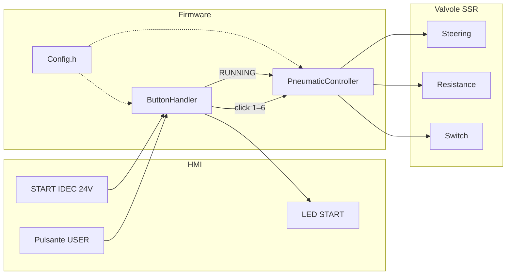
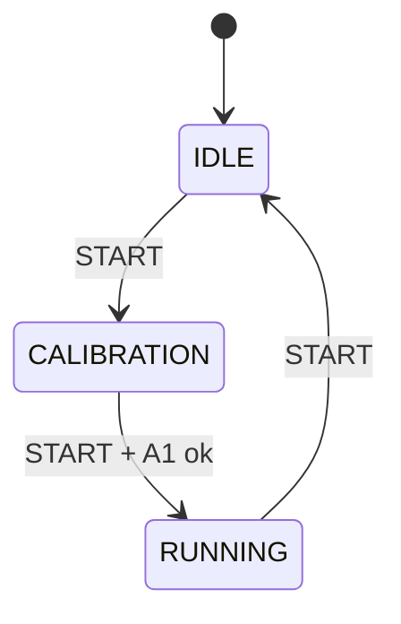

# Steering Test

Firmware **preliminary** per il banco sterzo Versive.

Tre valvole pneumatiche (sterzo, resistenza, switch) su Arduino **Opta** + espansione **Digital Solid State (SSR)**.

[](https://docs.arduino.cc/hardware/opta/)
[](#)
[](#limiti-attuali)

Due modi d’uso:

1. **Test valvola** — click sul pulsante USER (stato IDLE)
2. **Ciclo macchina** — programma in `executeRunningCommand()` (stato RUNNING)

> [!IMPORTANT]
> Dopo ogni modifica: **Verifica → Carica** sulla Opta.  
> `Config.h` è compilato nel firmware: reset della scheda **non** applica i nuovi valori.

---

## Indice

- [Architettura](#architettura)
- [Hardware](#hardware)
- [Stati della macchina](#stati-della-macchina)
- [Config.h](#configh)
- [Test con il pulsante USER](#test-con-il-pulsante-user)
- [Programma RUNNING](#programma-running)
- [Build e upload](#build-e-upload)
- [Limiti attuali](#limiti-attuali)

---

## Architettura

Cambi quasi solo **due file**: `Config.h` (pin e tempi) e `PneumaticController.cpp` (ciclo RUNNING).

```text
SteeringTest/
├── SteeringTest.ino          # setup / loop, wiring oggetti
├── Config.h                  # pin, tempi, mappa click USER
├── DoubleSolenoid.h/.cpp     # una valvola = due SSR
├── ButtonHandler.h/.cpp      # pulsanti, LED, FSM
├── PneumaticController.h/.cpp
└── README.md
```



| Modulo | Ruolo |
|---|---|
| `SteeringTest.ino` | Composition root: pin, `setup()`, `loop()` |
| `Config.h` | Costanti (non è una classe) |
| `DoubleSolenoid` | `extend()` / `retract()` / `stop()` |
| `ButtonHandler` | Ingressi + LED + stati IDLE / CALIBRATION / RUNNING |
| `PneumaticController` | Test USER + **programma di banco** |

---

## Hardware

Scheda: **Arduino Opta** (`arduino:mbed_opta:opta`)  
Libreria: [Arduino_Opta_Blueprint](https://github.com/arduino-libraries/Arduino_Opta_Blueprint) (`OptaBlue.h`)  
Espansione: prima Digital Solid State → `OptaController.getExpansion(0)`

Indici software: **0 = primo SSR**. Il LED START è l’SSR **fisico 7** = indice **6**.

| Funzione | Pin / SSR | Note |
|---|---|---|
| Steering A / B | 0, 1 | `extend` / `retract` |
| Resistance A / B | 2, 3 | `extend` / `retract` |
| Switch A / B | 4, 5 | `extend` / `retract` |
| LED START | 6 | SSR fisico 7 |
| Pulsante USER | `BTN_USER` | pull-up, attivo basso |
| START IDEC | `A0` (L1) | 24 V quando premuto |
| Sensore calibrazione | `A1` | cablato, **ancora simulato nel codice** |

Su ogni valvola:

| Metodo | Bobine |
|---|---|
| `extend()` | A ON, B OFF |
| `retract()` | A OFF, B ON |
| `stop()` | A OFF, B OFF |

Se una valvola si muove al contrario, in `Config.h` **scambia A e B** di quella coppia.

---

## Stati della macchina

Il pulsante **START** avanza di uno stato a ogni pressione:



| Stato | LED START | Comportamento |
|---|---|---|
| **IDLE** | spento | Test USER. Nessun ciclo macchina |
| **CALIBRATION** | lampeggia | Attende il secondo START |
| **RUNNING** | fisso acceso | `loop()` chiama `executeRunningCommand()` |

Serial Monitor a **115200** baud: messaggi tipo `SYSTEM -> RUNNING`.

> [!WARNING]
> In calibrazione il sensore A1 è **finto** (`calibrationReached = true` in `ButtonHandler.cpp`).  
> La lettura reale è commentata. Quando il finecorsa è cablato, togli il fake.

---

## Config.h

`Config` è un **namespace** di costanti, non un oggetto. Si usa così: `Config::Pins::STEERING_A`.

Apri questo file per cablaggio e tempi. **Non** ci va il ciclo pneumatico RUNNING.

### Pin

```cpp
namespace Pins {
    constexpr int STEERING_A    = 0;
    constexpr int STEERING_B    = 1;
    constexpr int RESISTANCE_A  = 2;
    constexpr int RESISTANCE_B  = 3;
    constexpr int SWITCH_A      = 4;
    constexpr int SWITCH_B      = 5;
    constexpr int START_LED     = 6;   // SSR fisico 7
    constexpr int USER_BUTTON   = BTN_USER;
    constexpr int START_BUTTON  = A0;
    constexpr int CALIBRATION   = A1;
}
```

### Tempi

| Costante | Default | Uso |
|---|---|---|
| `DEBOUNCE_MS` | 30 | antirimbalzo |
| `USER_CLICK_WINDOW_MS` | 3000 | attesa dopo l’ultimo click USER |
| `START_LED_BLINK_MS` | 500 | lampeggio in CALIBRATION |
| `SWITCH_PULSE_MS` | 500 | impulso switch nei **test** click 5 e 6 |
| `SerialPort::BAUD` | 115200 | Serial Monitor |

Le pause del **ciclo RUNNING** si scrivono nel metodo, non qui (salvo riusare `SWITCH_PULSE_MS`).

### Mappa click USER

`CMD_STEERING_RIGHT = 1`, … `CMD_SWITCH_OFF = 6`.  
Cambia i numeri solo se vuoi un altro conteggio. La logica resta in `executeTestCommand()`.

---

## Test con il pulsante USER

Utile in **IDLE**. In RUNNING il ciclo continua a comandare le valvole e sovrascrive il test.

1. Premi USER **N** volte  
2. Non premere per **3 s** (`USER_CLICK_WINDOW_MS`)  
3. Parte il comando N  

| Click | Azione | Codice |
|---|---|---|
| 1 | sterzo destra | `steering->extend()` |
| 2 | sterzo sinistra | `steering->retract()` |
| 3 | resistenza sinistra | `resistance->extend()` |
| 4 | resistenza destra | `resistance->retract()` |
| 5 | switch ON | impulso `extend` → `stop` |
| 6 | switch OFF | impulso `retract` → `stop` |
| altro | emergenza software | `stopAll()` |

Click 5 e 6 usano `delay(Config::Timing::SWITCH_PULSE_MS)`.

---

## Programma RUNNING

**File:** `PneumaticController.cpp`  
**Funzione:** `executeRunningCommand()`

Questa è l’unica funzione da editare per il ciclo di banco.

```cpp
void PneumaticController::executeRunningCommand() {
    Serial.println("MACHINE RUNNING..");

    switchValve->extend();
    steering->extend();
    resistance->retract();
}
```

> [!NOTE]
> In RUNNING questa funzione è chiamata **ad ogni giro di `loop()`**.  
> Non è “esegui una volta”: tiene le posizioni (o ripete la sequenza) finché resti in RUNNING.

### Valvole disponibili

- `steering`
- `resistance`
- `switchValve`

### Esempio — posa fissa

```cpp
void PneumaticController::executeRunningCommand() {
    steering->retract();
    resistance->stop();
    switchValve->extend();
}
```

### Esempio — sequenza con pause

```cpp
void PneumaticController::executeRunningCommand() {
    switchValve->extend();
    delay(Config::Timing::SWITCH_PULSE_MS);
    switchValve->stop();

    steering->extend();
    resistance->retract();
    delay(2000);

    steering->retract();
    delay(2000);

    steering->stop();
    resistance->stop();
    delay(500);
}
```

Finita la sequenza, **ricomincia da capo** finché sei in RUNNING. START di nuovo → IDLE.

> [!CAUTION]
> `delay()` blocca pulsanti e LED per tutta la pausa. Va bene per un test preliminare.  
> In IDLE le valvole **non** vanno in `stop()` da sole: restano sull’ultimo comando.

`Serial.println("MACHINE RUNNING..")` a ogni loop satura il Monitor: commentalo se usi una posa fissa senza `delay`.

---

## Build e upload

**Arduino IDE 2**

1. Apri la cartella sketch `SteeringTest` (il `.ino` deve avere lo stesso nome della cartella)
2. Scheda: **Arduino Opta**
3. Installa la libreria **Arduino_Opta_Blueprint**
4. Porta della Opta → **Carica**

**arduino-cli**

```bash
arduino-cli compile --fqbn arduino:mbed_opta:opta SteeringTest
arduino-cli upload  --fqbn arduino:mbed_opta:opta -p /dev/ttyACM0 SteeringTest
```

Su macOS la porta è spesso `/dev/cu.usbmodem*`.

---

## Limiti attuali

Funziona come **test preliminare**. Non c’è ancora:

- [ ] Finecorsa calibrazione A1 reale
- [ ] `stopAll()` automatico sul ritorno in IDLE
- [ ] Sequenza RUNNING a tabella in Config (volutamente nel metodo, più diretto)
- [ ] Attese non bloccanti (`millis`) nel ciclo macchina

In `PneumaticController.h` restano dichiarati `update()` e `handleSwitchPulse()` non implementati: non sono chiamati, non bloccano la compilazione.
