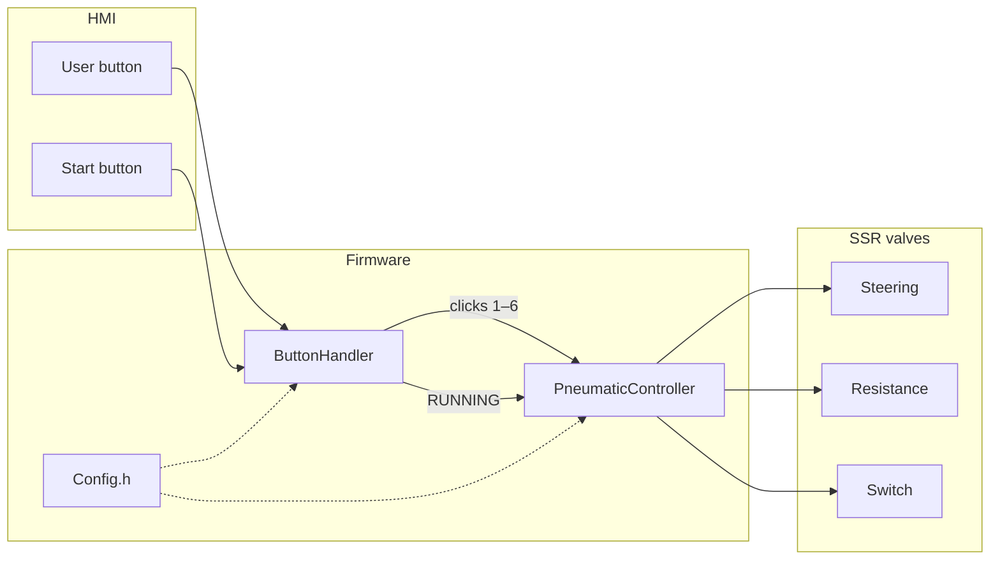
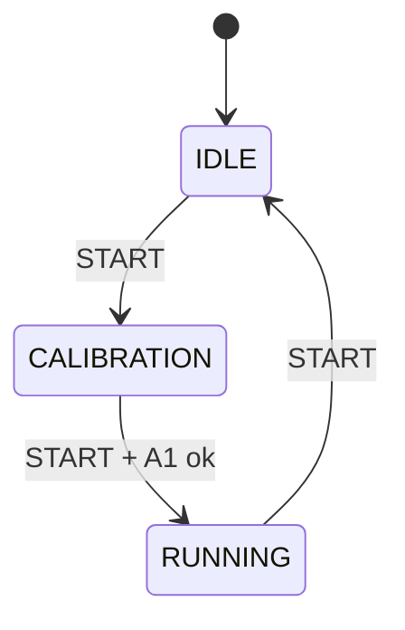

# Steering Test

**Preliminary** firmware for the Versive steering test stand.

Three pneumatic valves (steering, resistance, switch) on an Arduino **Opta** + **Digital Solid State (SSR)** expansion.

[](https://docs.arduino.cc/hardware/opta/)
[](#)
[](#current-limits)

Two ways to use it:

1. **Valve test** — click the USER button (IDLE state)
2. **Machine cycle** — program in `executeRunningCommand()` (RUNNING state)

> [!IMPORTANT]
> After every change: **Verify → Upload** to the Opta.  
> `Config.h` is compiled into the firmware: resetting the board does **not** apply the new values.

---

## Contents

- [Architecture](#architecture)
- [Hardware](#hardware)
- [Machine states](#machine-states)
- [Config.h](#configh)
- [Test with the USER button](#test-with-the-user-button)
- [RUNNING program](#running-program)
- [Build and upload](#build-and-upload)
- [Current limits](#current-limits)

---

## Architecture

You almost only change **two files**: `Config.h` (pins and timings) and `PneumaticController.cpp` (RUNNING cycle).

```text
SteeringTest/
├── SteeringTest.ino          # setup / loop, object wiring
├── Config.h                  # pins, timings, USER click map
├── DoubleSolenoid.h/.cpp     # one valve = two SSRs
├── ButtonHandler.h/.cpp      # buttons, LED, FSM
├── PneumaticController.h/.cpp
└── README.md
```



| Module | Role |
|---|---|
| `SteeringTest.ino` | Composition root: pins, `setup()`, `loop()` |
| `Config.h` | Constants (it is not a class) |
| `DoubleSolenoid` | `extend()` / `retract()` / `stop()` |
| `ButtonHandler` | Inputs + LED + IDLE / CALIBRATION / RUNNING states |
| `PneumaticController` | USER test + **stand program** |

---

## Hardware

Board: **Arduino Opta** (`arduino:mbed_opta:opta`)  
Library: [Arduino_Opta_Blueprint](https://github.com/arduino-libraries/Arduino_Opta_Blueprint) (`OptaBlue.h`)  
Expansion: first Digital Solid State → `OptaController.getExpansion(0)`

Software indices: **0 = first SSR**. The START LED is physical SSR **7** = index **6**.

| Function | Pin / SSR | Notes |
|---|---|---|
| Steering A / B | 0, 1 | `extend` / `retract` |
| Resistance A / B | 2, 3 | `extend` / `retract` |
| Switch A / B | 4, 5 | `extend` / `retract` |
| START LED | 6 | physical SSR 7 |
| USER button | `BTN_USER` | pull-up, active low |
| START IDEC | `A0` (L1) | 24 V when pressed |
| Calibration sensor | `A1` | wired, **still simulated in code** |

On each valve:

| Method | Coils |
|---|---|
| `extend()` | A ON, B OFF |
| `retract()` | A OFF, B ON |
| `stop()` | A OFF, B OFF |

If a valve moves the wrong way, in `Config.h` **swap A and B** of that pair.

---

## Machine states

The **START** button advances one state on each press:



| State | START LED | Behavior |
|---|---|---|
| **IDLE** | off | USER test. No machine cycle |
| **CALIBRATION** | blinking | Waits for the second START |
| **RUNNING** | steady on | `loop()` calls `executeRunningCommand()` |

Serial Monitor at **115200** baud: messages such as `SYSTEM -> RUNNING`.

> [!WARNING]
> During calibration the A1 sensor is **faked** (`calibrationReached = true` in `ButtonHandler.cpp`).  
> The real read is commented out. When the limit switch is wired, remove the fake.

---

## Config.h

`Config` is a **namespace** of constants, not an object. Use it like this: `Config::Pins::STEERING_A`.

Open this file for wiring and timings. The RUNNING pneumatic cycle does **not** go here.

### Pins

```cpp
namespace Pins {
    constexpr int STEERING_A    = 0;
    constexpr int STEERING_B    = 1;
    constexpr int RESISTANCE_A  = 2;
    constexpr int RESISTANCE_B  = 3;
    constexpr int SWITCH_A      = 4;
    constexpr int SWITCH_B      = 5;
    constexpr int START_LED     = 6;   // physical SSR 7
    constexpr int USER_BUTTON   = BTN_USER;
    constexpr int START_BUTTON  = A0;
    constexpr int CALIBRATION   = A1;
}
```

### Timings

| Constant | Default | Use |
|---|---|---|
| `DEBOUNCE_MS` | 30 | debounce |
| `USER_CLICK_WINDOW_MS` | 3000 | wait after the last USER click |
| `START_LED_BLINK_MS` | 500 | blink in CALIBRATION |
| `SWITCH_PULSE_MS` | 500 | switch pulse in **tests** clicks 5 and 6 |
| `SerialPort::BAUD` | 115200 | Serial Monitor |

Pauses in the **RUNNING cycle** are written in the method, not here (unless you reuse `SWITCH_PULSE_MS`).

### USER click map

`CMD_STEERING_RIGHT = 1`, … `CMD_SWITCH_OFF = 6`.  
Change the numbers only if you want a different count. The logic stays in `executeTestCommand()`.

---

## Test with the USER button

Useful in **IDLE**. In RUNNING the cycle keeps commanding the valves and overwrites the test.

1. Press USER **N** times  
2. Do not press for **3 s** (`USER_CLICK_WINDOW_MS`)  
3. Command N starts  

| Clicks | Action | Code |
|---|---|---|
| 1 | steering right | `steering->extend()` |
| 2 | steering left | `steering->retract()` |
| 3 | resistance left | `resistance->extend()` |
| 4 | resistance right | `resistance->retract()` |
| 5 | switch ON | `extend` pulse → `stop` |
| 6 | switch OFF | `retract` pulse → `stop` |
| other | software emergency | `stopAll()` |

Clicks 5 and 6 use `delay(Config::Timing::SWITCH_PULSE_MS)`.

---

## RUNNING program

**File:** `PneumaticController.cpp`  
**Function:** `executeRunningCommand()`

This is the only function to edit for the stand cycle.

```cpp
void PneumaticController::executeRunningCommand() {
    Serial.println("MACHINE RUNNING..");

    switchValve->extend();
    steering->extend();
    resistance->retract();
}
```

> [!NOTE]
> In RUNNING this function is called **on every `loop()` turn**.  
> It is not “run once”: it holds the positions (or repeats the sequence) for as long as you stay in RUNNING.

### Available valves

- `steering`
- `resistance`
- `switchValve`

### Example — fixed pose

```cpp
void PneumaticController::executeRunningCommand() {
    steering->retract();
    resistance->stop();
    switchValve->extend();
}
```

### Example — sequence with pauses

```cpp
void PneumaticController::executeRunningCommand() {
    switchValve->extend();
    delay(Config::Timing::SWITCH_PULSE_MS);
    switchValve->stop();

    steering->extend();
    resistance->retract();
    delay(2000);

    steering->retract();
    delay(2000);

    steering->stop();
    resistance->stop();
    delay(500);
}
```

When the sequence ends, it **starts over** for as long as you are in RUNNING. START again → IDLE.

> [!CAUTION]
> `delay()` blocks buttons and the LED for the whole pause. Fine for a preliminary test.  
> In IDLE the valves do **not** go to `stop()` on their own: they stay on the last command.

`Serial.println("MACHINE RUNNING..")` on every loop floods the Monitor: comment it out if you use a fixed pose without `delay`.

---

## Build and upload

**Arduino IDE 2**

1. Open the `SteeringTest` sketch folder (the `.ino` must have the same name as the folder)
2. Board: **Arduino Opta**
3. Install the **Arduino_Opta_Blueprint** library
4. Opta port → **Upload**

**arduino-cli**

```bash
arduino-cli compile --fqbn arduino:mbed_opta:opta SteeringTest
arduino-cli upload  --fqbn arduino:mbed_opta:opta -p /dev/ttyACM0 SteeringTest
```

On macOS the port is often `/dev/cu.usbmodem*`.

---

## Current limits

It works as a **preliminary test**. Not yet present:

- [ ] Real A1 calibration limit switch
- [ ] Automatic `stopAll()` when returning to IDLE
- [ ] RUNNING sequence as a table in Config (kept in the method on purpose, more direct)
- [ ] Non-blocking waits (`millis`) in the machine cycle

`update()` and `handleSwitchPulse()` are still declared in `PneumaticController.h` and not implemented: they are not called, and they do not block compilation.
