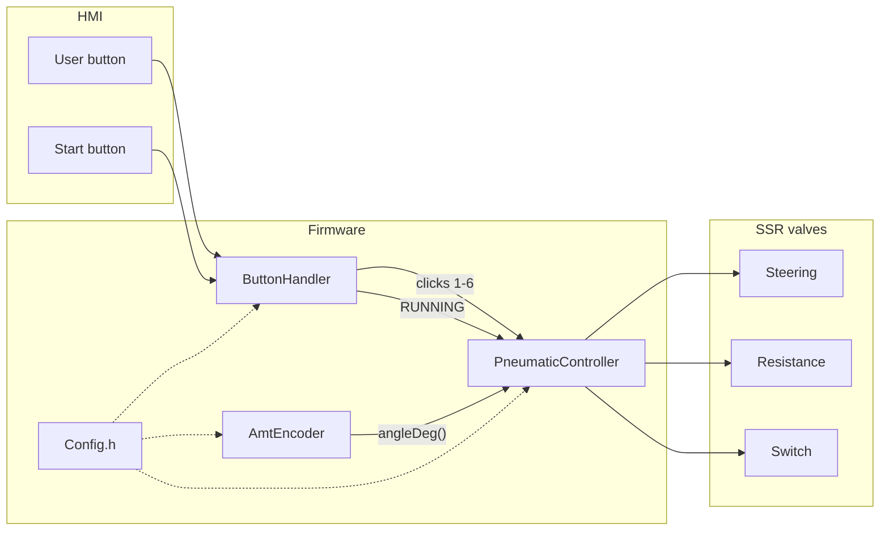
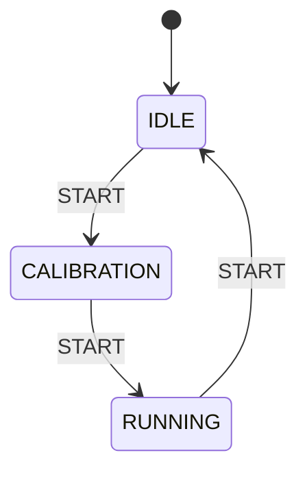
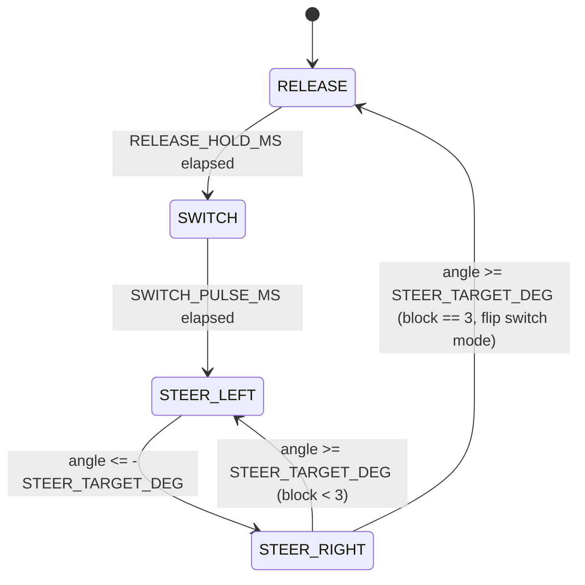

# Steering Test

Firmware for the Versive wheelchair front-wheel steering fatigue test stand.

Three pneumatic valves (steering, resistance, switch) on an Arduino **Opta** +
**Digital Solid State (SSR)** expansion, plus an **AMT103** quadrature encoder
reading the real front-wheel rotation angle.

[](https://docs.arduino.cc/hardware/opta/)
[](#)

> [!IMPORTANT]
> After every change: **Verify → Upload** to the Opta.
> `Config.h` is compiled into the firmware: resetting the board does **not** apply new values.

---

## Contents

- [Architecture](#architecture)
- [Hardware](#hardware)
- [Machine states](#machine-states)
- [Config.h](#configh)
- [Test with the USER button](#test-with-the-user-button)
- [Automatic RUNNING sequence](#automatic-running-sequence)
- [Build and upload](#build-and-upload)
- [Current limits](#current-limits)

---

## Architecture

```text
SteeringTest/
├── SteeringTest.ino          # setup / loop, object wiring
├── Config.h                  # pins, timings, encoder settings, USER click map
├── DoubleSolenoid.h/.cpp     # one valve = two SSRs (extend/retract/stop)
├── ButtonHandler.h/.cpp      # USER/START buttons, LED, IDLE/CALIBRATION/RUNNING FSM
├── AmtEncoder.h/.cpp         # AMT103 quadrature decode (hysteresis), angleDeg()
├── PneumaticController.h/.cpp
├── run.cpp                   # automatic RUNNING cycle (PneumaticController::run())
└── README.md
```



| Module | Role |
|---|---|
| `SteeringTest.ino` | Composition root: pins, `setup()`, `loop()` |
| `Config.h` | Constants (it is not a class) |
| `DoubleSolenoid` | `extend()` / `retract()` / `stop()` |
| `ButtonHandler` | Inputs + LED + IDLE / CALIBRATION / RUNNING states |
| `AmtEncoder` | Quadrature decode with hysteresis, cumulative `angleDeg()` |
| `PneumaticController` | USER test (`test()`) + automatic cycle (`run()`) |

---

## Hardware

Board: **Arduino Opta** (`arduino:mbed_opta:opta`)
Library: [Arduino_Opta_Blueprint](https://github.com/arduino-libraries/Arduino_Opta_Blueprint) (`OptaBlue.h`)
Expansion: first Digital Solid State → `OptaController.getExpansion(0)`

Software indices: **0 = first SSR**. The START LED is physical SSR **7** = index **6**.

| Function | Pin / SSR | Notes |
|---|---|---|
| Steering A / B | 0, 1 | `extend` / `retract` |
| Resistance A / B | 2, 3 | `extend` / `retract` |
| Switch A / B | 4, 5 | `extend` / `retract` |
| START LED | 6 | physical SSR 7 |
| USER button | `BTN_USER` | pull-up, active low |
| START button | `A0` (I1, L1) | 24 V when pressed |
| Encoder 1 A / B / X | `A2` (I3) / `A3` (I4) / `A4` (I5) | AMT103 on the front wheel shaft (in use) |
| Encoder 2 A / B / X | `A5` (I6) / `A6` (I7) / `A7` (I8) | AMT103, second shaft (in use, `USE_ENCODER2 = true`) |

On each valve:

| Method | Coils |
|---|---|
| `extend()` | A ON, B OFF |
| `retract()` | A OFF, B ON |
| `stop()` | A OFF, B OFF |

If a valve moves the wrong way, in `Config.h` **swap A and B** of that pair.

### AMT103 encoder

`encoder1` is mounted on the shaft of the front wheel/caster assembly, so
`angleDeg()` reads the real wheel rotation angle directly — not an abstract
actuator position. Analog channels A/B are decoded with hysteresis
(`HIGH_THRESHOLD` / `LOW_THRESHOLD` in `Config.h`) to avoid phantom counts
from noise near the switching point. `PPR` (2048) must match the AMT103's
DIP switch setting. The X index channel is read only as a raw live value
during CALIBRATION (see below) — it is **not** used to auto-zero the encoder.

---

## Machine states

The **START** button advances one state on each press:



| State | START LED | Behavior |
|---|---|---|
| **IDLE** | off | USER test only. No automatic cycle. On entry, all valves are stopped. |
| **CALIBRATION** | blinking | Operator rotates the wheel by hand to the desired zero position. Live raw `analogRead` of the X channel is printed so it can be found by eye. No valve is driven. |
| **RUNNING** | steady on | `encoder1.zero()` is called on entry (whatever position the wheel is in at that instant becomes 0°), `pneumatic.run()` cycles the valves on every `loop()` |

Serial Monitor at **115200** baud shows state transitions (`SYSTEM -> RUNNING`, etc.)
and the live signed wheel angle while RUNNING.

> [!NOTE]
> There is no hardware calibration sensor / limit switch. CALIBRATION is purely
> a manual positioning step; the second START press always succeeds and zeros
> the encoder wherever the wheel physically is.

---

## Config.h

`Config` is a **namespace** of constants, not an object: `Config::Pins::STEERING_A`.

### Pins

```cpp
namespace Pins {
    constexpr int STEERING_A    = 0;
    constexpr int STEERING_B    = 1;
    constexpr int RESISTANCE_A  = 2;
    constexpr int RESISTANCE_B  = 3;
    constexpr int SWITCH_A      = 4;
    constexpr int SWITCH_B      = 5;
    constexpr int START_LED     = 6;   // physical SSR 7
    constexpr int USER_BUTTON   = BTN_USER;
    constexpr int START_BUTTON  = A0;
    constexpr int ENC1_A        = A2;  // I3
    constexpr int ENC1_B        = A3;  // I4
    constexpr int ENC1_X        = A4;  // I5
    constexpr int ENC2_A        = A5;  // I6
    constexpr int ENC2_B        = A6;  // I7
    constexpr int ENC2_X        = A7;  // I8
}
```

### Encoder

| Constant | Default | Use |
|---|---|---|
| `PPR` | 2048 | must match the AMT103 DIP switch |
| `USE_ENCODER2` | true | both encoders wired and sampled |
| `HIGH_THRESHOLD` / `LOW_THRESHOLD` | 700 / 200 | hysteresis band (12-bit ADC) |
| `PRINT_MS` | 50 | live Serial print period (does **not** throttle sampling — `encoder.update()` runs every `loop()` iteration) |

### Timings

| Constant | Default | Use |
|---|---|---|
| `DEBOUNCE_MS` | 30 | button debounce |
| `USER_CLICK_WINDOW_MS` | 3000 | wait after the last USER click before executing the command |
| `START_LED_BLINK_MS` | 500 | LED blink in CALIBRATION |
| `SWITCH_PULSE_MS` | 500 | switch pulse duration (USER test clicks 5/6, and each automatic switch pulse) |
| `RELEASE_HOLD_MS` | 1000 | all valves stopped, held before every switch pulse |
| `Run::STEER_TARGET_DEG` | 30.0 | wheel angle magnitude (deg) each steering stroke must reach |
| `SerialPort::BAUD` | 115200 | Serial Monitor |

### USER click map

```cpp
enum TestCommand {
    CMD_STOP             = 0,
    CMD_STEERING_RIGHT   = 1,
    CMD_STEERING_LEFT    = 2,
    CMD_RESISTANCE_LEFT  = 3,
    CMD_RESISTANCE_RIGHT = 4,
    CMD_SWITCH_ON        = 5,
    CMD_SWITCH_OFF       = 6
};
```

---

## Test with the USER button

Useful in **IDLE**. In RUNNING the automatic cycle keeps commanding the valves
and overwrites any test command.

1. Press USER **N** times
2. Do not press for **3 s** (`USER_CLICK_WINDOW_MS`)
3. Command N executes

| Clicks | Action | Code |
|---|---|---|
| 1 | steering right | `steering->extend()` |
| 2 | steering left | `steering->retract()` |
| 3 | resistance left | `resistance->extend()` |
| 4 | resistance right | `resistance->retract()` |
| 5 | switch ON | `extend` pulse → `stop` |
| 6 | switch OFF | `retract` pulse → `stop` |
| other | software emergency stop | `stopAll()` |

Clicks 5 and 6 use a blocking `delay(Config::Timing::SWITCH_PULSE_MS)` — this
is the only place `delay()` is still used in the firmware, and it is never
reachable from the automatic RUNNING cycle.

---

## Automatic RUNNING sequence

**File:** `run.cpp` (method `PneumaticController::run()`, declared in
`PneumaticController.h`). Called from `loop()` on every iteration while
RUNNING. Entirely non-blocking (`millis()`-based state machine, no `delay()`),
so encoder sampling in `loop()` is never interrupted.

It loops forever between two modes, flipping mode every 3 steering blocks:

- **Switch LEFT** ("Lenkmodus")
- **Switch RIGHT** ("normal modus")



| Phase | Behavior |
|---|---|
| `RELEASE` | Steering, resistance, and switch valves all `stop()`. Held for `RELEASE_HOLD_MS`. |
| `SWITCH` | Switch valve pulses LEFT or RIGHT for `SWITCH_PULSE_MS`, then `stop()`. |
| `STEER_LEFT` | Steer LEFT + resistance RIGHT, until `encoder1.angleDeg() <= -STEER_TARGET_DEG`. |
| `STEER_RIGHT` | Steer RIGHT + resistance LEFT, until `encoder1.angleDeg() >= STEER_TARGET_DEG`. |

Steering strokes are **closed-loop on the real wheel angle**, not a fixed
time: `steering` and `resistance` push in opposite directions with different
load/friction, so a fixed actuation time would make left/right travel
slightly asymmetric and drift cycle over cycle. Ending every stroke at the
same measured angle keeps the cycle stable indefinitely.

`STEER_LEFT`/`STEER_RIGHT` alternate 3 times (`runBlockCount`), identically
regardless of switch mode — only the `SWITCH` phase's pulse direction
depends on it. After the 3rd block the switch mode flips and the sequence
returns to `RELEASE`.

On the **2nd START press** (CALIBRATION → RUNNING), `SteeringTest.ino` calls
`encoder1.zero()` and `pneumatic.resetRun()` together, so the automatic cycle
always restarts cleanly from `RELEASE` with a fresh zero reference — a stale
leftover phase/timestamp from a previous run can never snap the valves into
motion before the encoder is zeroed.

On the **3rd START press** (RUNNING → IDLE), `pneumatic.test(Config::CMD_STOP)`
releases all valves so nothing stays energized between runs.

---

## Build and upload

**Arduino IDE 2**

1. Open the `SteeringTest` sketch folder (the `.ino` must have the same name as the folder)
2. Board: **Arduino Opta**
3. Install the **Arduino_Opta_Blueprint** library
4. Opta port → **Upload**

**arduino-cli**

```bash
arduino-cli compile --fqbn arduino:mbed_opta:opta SteeringTest
arduino-cli upload  --fqbn arduino:mbed_opta:opta -p /dev/ttyACM0 SteeringTest
```

On macOS the port is often `/dev/cu.usbmodem*`.

---

## Current limits

- No hardware calibration sensor / limit switch — CALIBRATION is manual positioning only.
- No CSV logging or stroke/fatigue cycle counting (removed by design, kept minimal).
- `update()` and `handleSwitchPulse()` are declared in `PneumaticController.h` but not implemented: they are not called, and they do not block compilation.
- `visualizations/plot_steering_angle.py` is an offline plotting script and is currently stale relative to the simplified no-CSV firmware (matches an older logging format).
